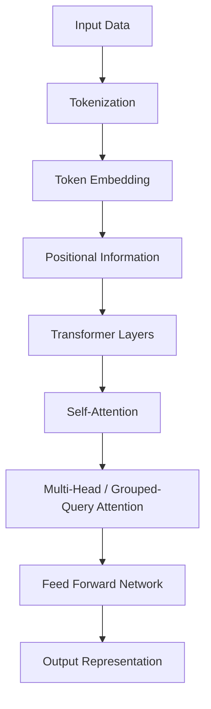

# Transformers
## Overview
- **Transformer**: Attention을 기반으로 입력 데이터 사이의 관계를 학습하는 신경망 아키텍처
- **적용 분야**: Language Models, Computer Vision, Video Understanding, Multimodal AI
- **핵심 구조**: 입력 표현 → Positional Encoding → Attention → Feed Forward Network → 출력
- **주요 특징**: Multi-Head Attention을 통한 정보 결합 및 병렬 연산

## Index
### 1. Input Representation
1. [[Tokenization]]
    - 텍스트·이미지·영상 등을 모델이 처리할 수 있는 토큰 단위로 변환
2. [[Token Embedding]]
    - 토큰을 고정된 차원의 벡터로 표현
3. [[Positional Encoding]]
    - 토큰의 순서 및 위치 정보 반영

### 2. Attention Mechanism
1. [[Attention]]
    - Query, Key, Value를 이용한 토큰 간 정보 결합
2. [[Self-Attention]]
    - 동일한 입력 시퀀스 내부의 토큰 간 관계 계산
3. [[Multi-Head Attention]]
    - 여러 Attention Head를 사용하여 서로 다른 표현 공간에서 관계 계산
4. [[Grouped-Query Attention]]
    - 여러 Query Head가 Key/Value Head를 공유하는 구조

### 3. Inference Optimization
1. [[KV Cache]]
    - 이전 토큰의 Key/Value를 저장하고 재사용하여 중복 계산 감소

### 4. Architecture
1. [[Transformer]]
    - Transformer 전체 구조 및 구성 요소
2. [[Feed-Forward Neural Network]]
    - Attention 이후 적용되는 비선형 변환 구조

## Processing Flow

## Related Concepts
- [[Softmax]] — Attention Score 및 Logits의 확률분포 변환
- [[Sampling]] — 확률분포를 기반으로 생성할 토큰 선택
- [[Normalization]] — 신경망 내부 데이터 정규화
- [[Matrix]] — Attention 및 선형 변환의 수학적 기반
- [[Language Models from Scratch ]] — 언어 모델 구현 및 학습