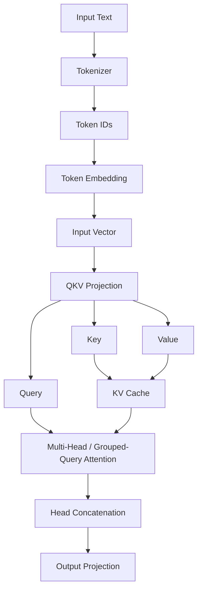
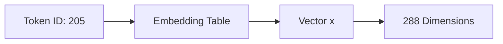
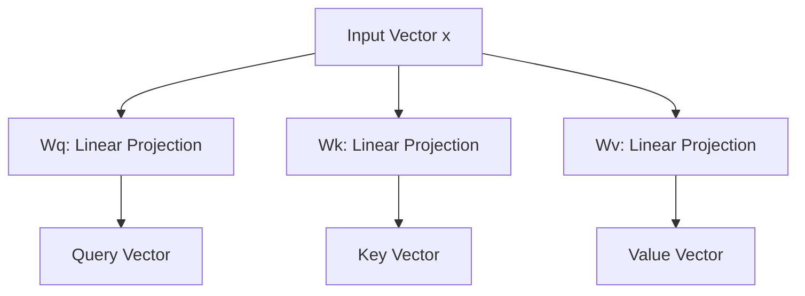
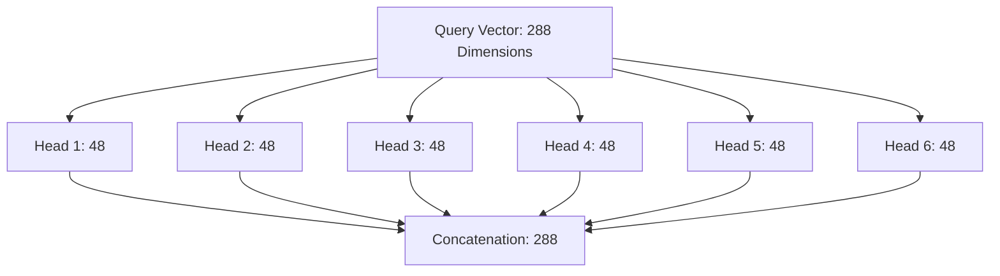
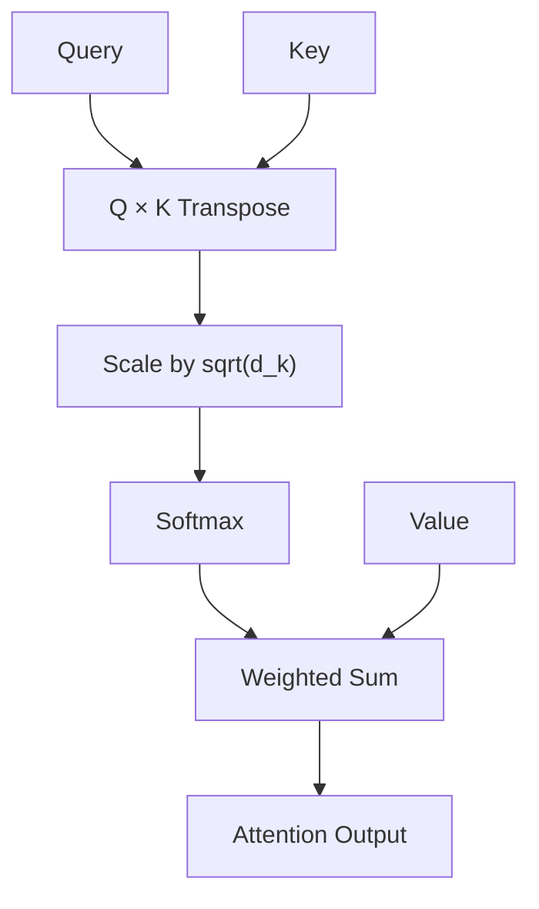
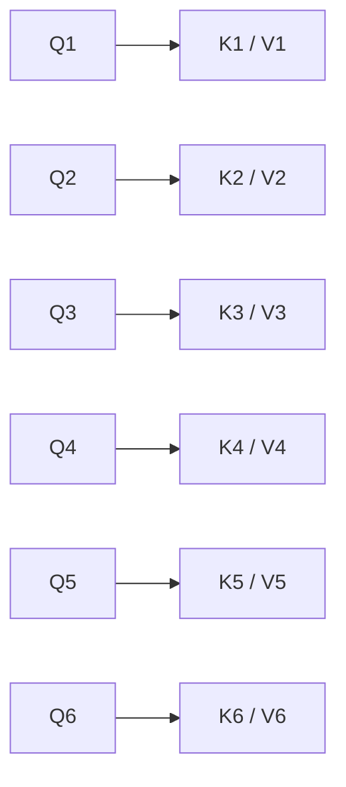
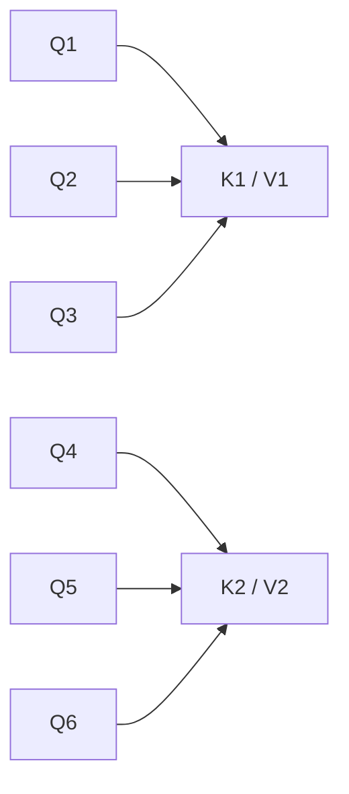
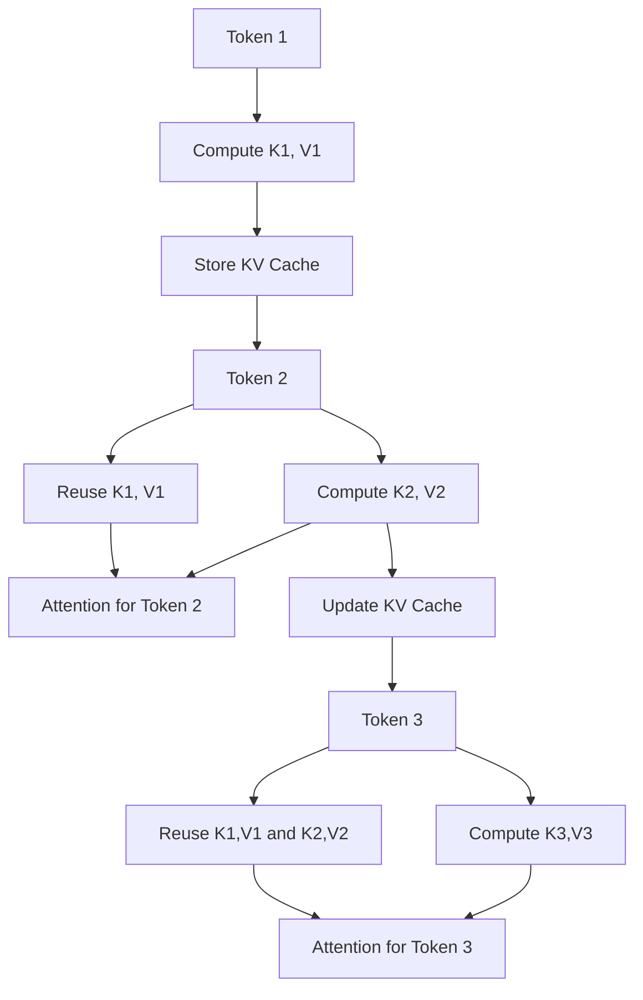
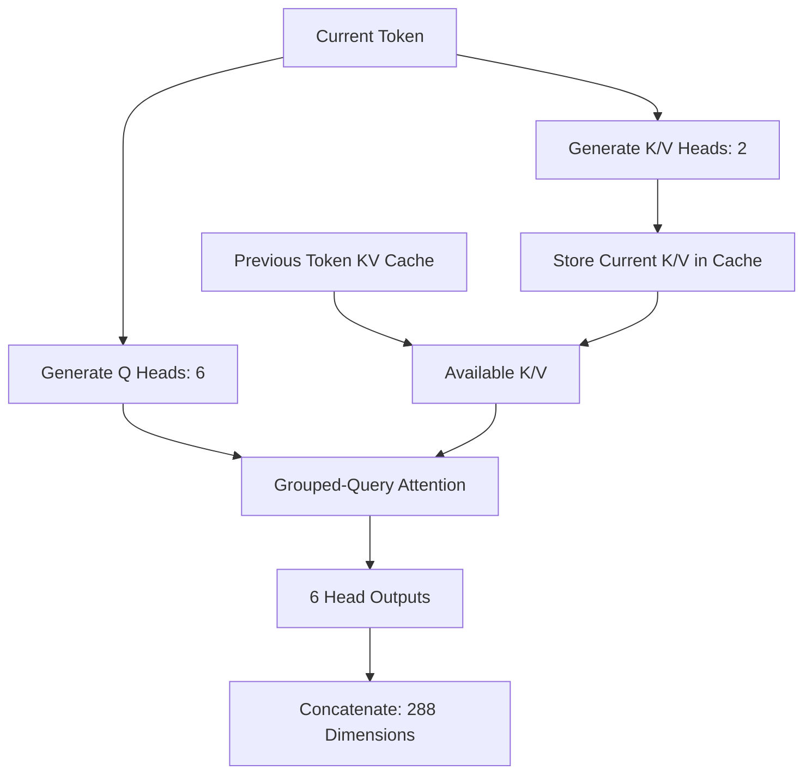
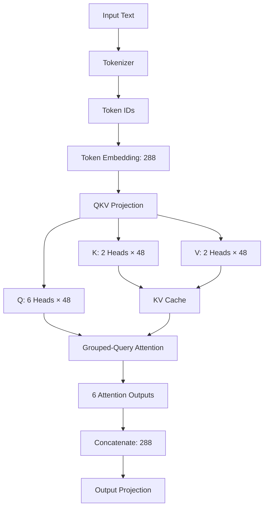

# Transformer Input & Attention
## 1. Overview
- **Tokenization**: 입력 텍스트를 Token ID로 변환 
- **Embedding**: Token ID를 고정 차원의 벡터로 변환
- **QKV Projection**: 가중치 행렬을 사용하여 Query, Key, Value 생성
- **Multi-Head Attention (MHA)**: 여러 Head에서 독립적으로 Attention 계산
- **Grouped-Query Attention (GQA)**: 여러 Query Head가 Key/Value Head 공유
- **KV Cache**: 이전 토큰의 Key/Value를 저장하고 재사용

### Processing Flow


## 2. Tokenization & Embedding
### Tokenization
입력 텍스트를 Vocabulary에 정의된 Token ID로 변환한다.
```
Input: "The cat sleeps"
          ↓
Tokens: ["The", "cat", "sleeps"]
          ↓
IDs: [101, 205, 309]
```
위 토큰 분할과 ID는 설명용 예시이다.
`run.c`에서 Tokenization을 수행하는 코드:
```
encode(t, prompt, 1, 0, &prompt_tokens, &num_prompt_tokens);
```

### Token Embedding
Token ID를 모델의 Embedding Table에서 조회하여 벡터로 변환한다.
```
float* content_row = w->token_embedding_table + token * dim;
memcpy(x, content_row, dim * sizeof(*x));
```
예를 들어 `dim = 288`이면 토큰 하나가 288개의 실수로 표현된다.
$$[  
x\in\mathbb{R}^{288}  
]$$


- **Token**: 텍스트를 분할한 처리 단위 
- **Dimension**: 토큰 하나를 표현하는 벡터의 숫자 개수
- **Embedding**: 학습된 벡터 표현

## 3. QKV Projection
입력 벡터를 학습된 가중치 행렬로 변환해 Q, K, V를 생성한다.
$$[  
Q=W_Qx,\quad K=W_Kx,\quad V=W_Vx  
]$$

|벡터|역할|
|---|---|
|Query (Q)|어떤 정보를 참고할지 판단하는 표현|
|Key (K)|Query와 비교하여 Attention Score 계산|
|Value (V)|Attention 결과에 반영할 정보|



`run.c`의 핵심 연산을 단순화한 코드:

```
matmul(q, x, wq, dim, dim);
matmul(k, x, wk, dim, kv_dim);
matmul(v, x, wv, dim, kv_dim);
```
- `wq`, `wk`, `wv`: 학습된 가중치
- `q`, `k`, `v`: 입력으로부터 계산된 벡터
- 실제 구현에서는 정규화된 입력과 레이어별 가중치 오프셋 사용

## 4. Multi-Head Attention (MHA)
**Q, K, V를 여러 Head로 나누어 각각 Attention을 계산하는 구조**

예시:
```
dim = 288;
n_heads = 6;
```
Head 하나의 차원:
$$[  
head\_size=\frac{288}{6}=48  
]$$



위 그림은 Query의 차원 분할을 보여준다. 실제로는 각 Head에 대응하는 K/V와 Attention을 계산한 **결과 벡터**를 결합한다.

Head는 단어 하나를 담당하는 것이 아니라, 토큰 간 관계를 계산하는 독립적인 Attention 연산 단위이다.

### Attention Calculation
$$[  
\operatorname{Attention}(Q,K,V)=  
\operatorname{softmax}  
\left(\frac{QK^T}{\sqrt{d_k}}\right)V  
]$$



1. Query와 Key의 내적으로 유사도 계산
2. Head 차원의 제곱근으로 점수 조절
3. Softmax로 Attention 가중치 계산
4. Value의 가중합으로 출력 생성

`run.c`에서는 Head별로 반복하여 Attention을 계산한다.

```
for (int h = 0; h < p->n_heads; h++) {
    float* q = s->q + h * head_size;
}
```

## 5. Grouped-Query Attention (GQA)
**여러 Query Head가 하나의 Key/Value Head를 공유하는 Attention 구조**

예시:
```
dim = 288;
n_heads = 6;
n_kv_heads = 2;
```

### MHA 구조

- Query Head: 6개
- Key/Value Head: 각각 6개
- Query Head마다 별도의 K/V Head 사용

### GQA 구조

- Query Head: 6개 
- Key/Value Head: 각각 2개
- Query Head 3개가 하나의 K/V Head 공유

### Dimension Calculation

$$[  
head\_size=\frac{dim}{n_heads}=48  
]$$

$$[  
kv\_dim=dim\times\frac{n_kv_heads}{n_heads}=96  
]$$

|구분|MHA|GQA|
|---|---|---|
|Query Heads|6|6|
|Key/Value Heads|6|2|
|Query Dimension|288|288|
|Key Dimension|288|96|
|Value Dimension|288|96|
|KV 공유|없음|있음|

`run.c`에서 KV Head를 선택하는 계산:
```
int kv_mul = p->n_heads / p->n_kv_heads;
int kv_head = h / kv_mul;
```

`kv_mul = 3`이므로 Query Head 3개마다 하나의 KV Head를 사용한다.
GQA는 KV Head 수를 줄여 Key/Value 저장 공간 및 메모리 접근 부담을 감소시킨다.

## 6. KV Cache
**이전 토큰에서 계산한 Key/Value를 저장하고 다음 토큰 처리에 재사용하는 메모리**
LLM은 토큰을 순차적으로 생성하므로 이전 토큰의 K/V를 반복 계산할 필요가 없다.

### KV Cache Processing


### Memory Allocation
`RunState` 구조체:
```
float* key_cache;
float* value_cache;
```

`malloc_run_state()`에서 메모리 할당:
```
int kv_dim = (p->dim * p->n_kv_heads) / p->n_heads;

s->key_cache = calloc(
    p->n_layers * p->seq_len * kv_dim,
    sizeof(float)
);

s->value_cache = calloc(
    p->n_layers * p->seq_len * kv_dim,
    sizeof(float)
);
```

- `n_layers`: Transformer Layer 개수
- `seq_len`: 최대 시퀀스 길이
- `kv_dim`: 토큰 하나의 Key 또는 Value 차원

FP32 기준 총 KV Cache 메모리:
$$[  
M_{KV}=2\times n_{layers}\times seq_{len}\times kv_{dim}\times4  
]$$

### GQA + KV Cache

- GQA: 여러 Query Head가 같은 KV Head를 공유
- KV Cache: 이전 토큰의 K/V를 재사용
- 두 기법을 결합하면 캐시 메모리를 줄이면서 중복 K/V 계산을 방지할 수 있다.

## 7. Summary


| 개념                      | 핵심 역할                  |
| ----------------------- | ---------------------- |
| Tokenizer               | 텍스트 → Token ID         |
| Embedding               | Token ID → 벡터          |
| QKV Projection          | Q/K/V 계산               |
| Multi-Head Attention    | 여러 Head에서 Attention 수행 |
| Grouped-Query Attention | 여러 Query Head가 K/V 공유  |
| KV Cache                | 이전 K/V 저장 및 재사용        |
